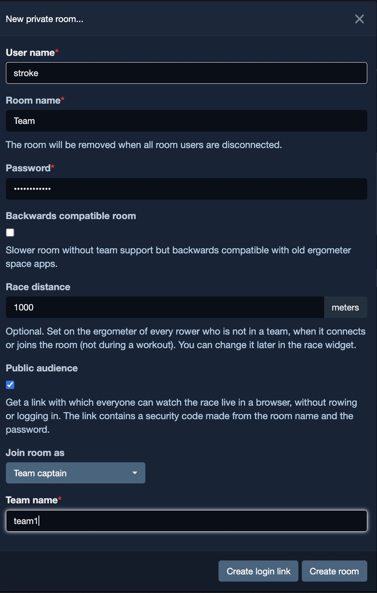
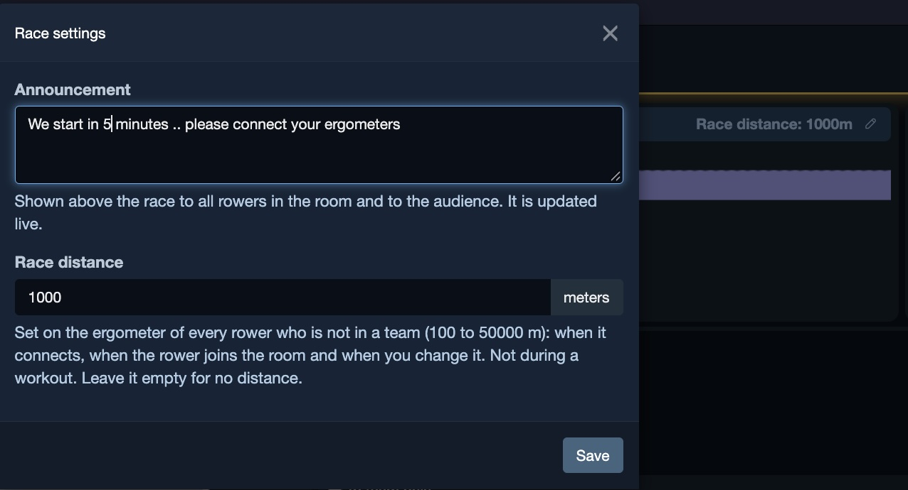
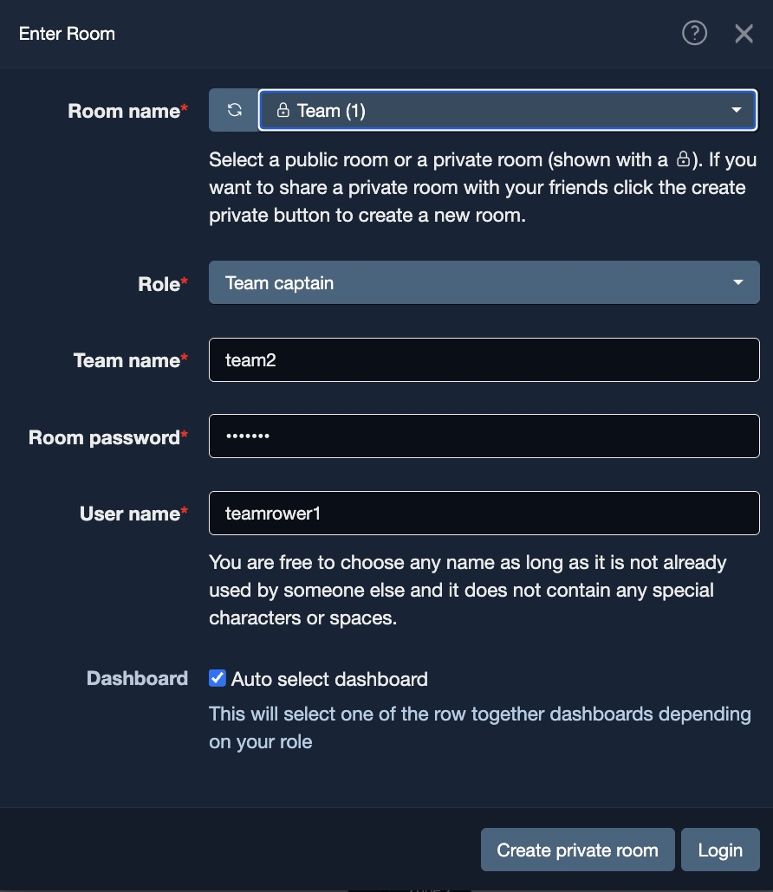
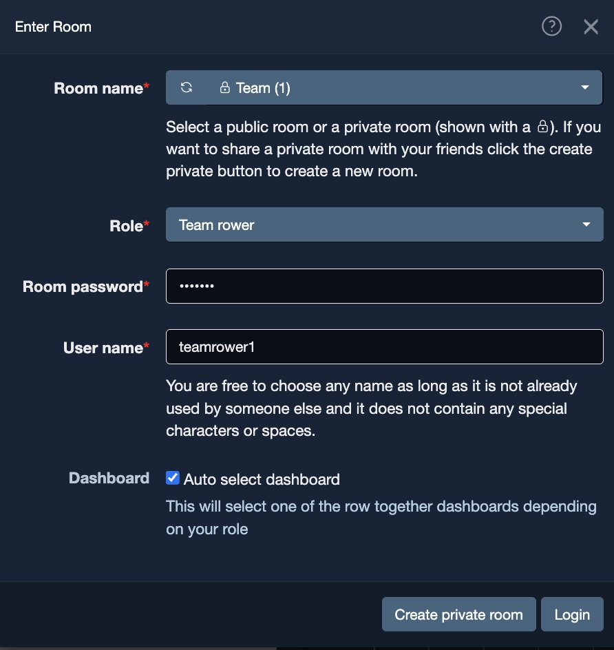
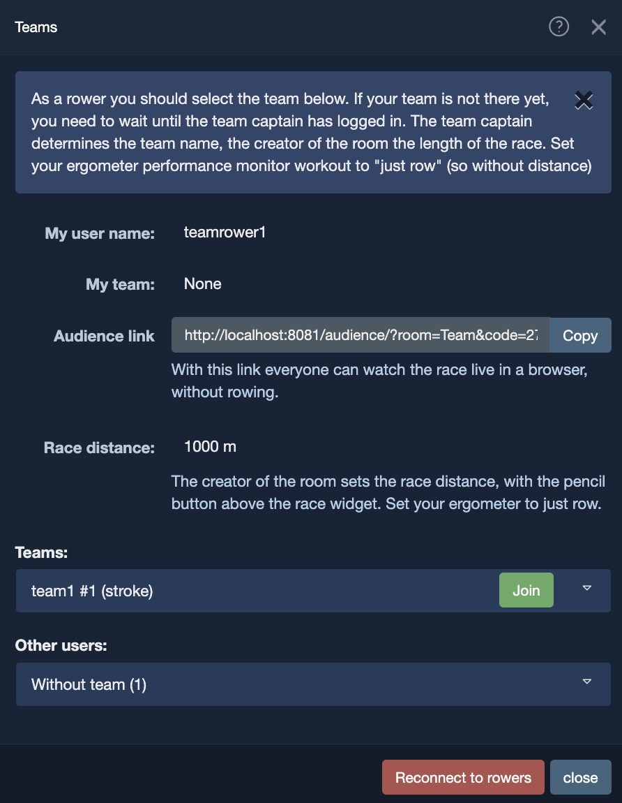
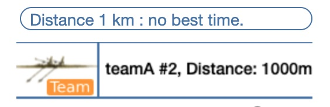
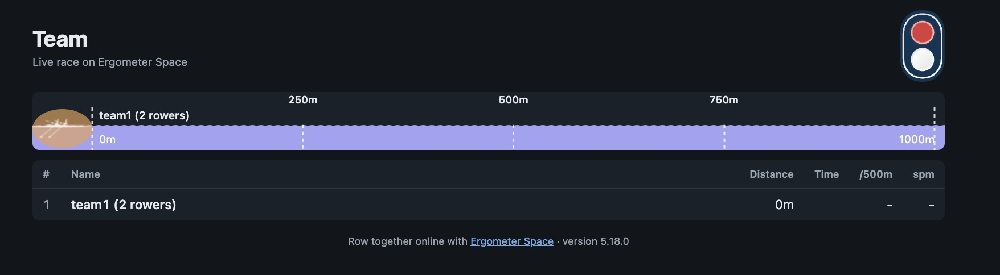
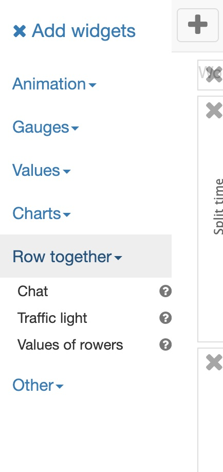

# Introduction

With Ergometer Space you can row together online. This document describes how to organize team rowing, and how rowers join a team and start racing.

Ergometer Space is available through:
* The [website](https://ergometer-space.org/). Use a recent Chromium-based web browser, like Chrome or Edge.
* Android: [download it from the Play Store](https://play.google.com/store/apps/details?id=org.tijmenvangulik.ergometerspace)
* iOS: [download it from the App Store](https://apps.apple.com/us/app/ergometer-space/id1548193188)

# Roles

There are 4 roles:

* Solo rower: a rower who does not row in a team and has their own boat.
* Team captain: the rower who creates a team. The team captain is the owner of the team (boat).
* Team rower: a rower who joins a team. All the rowers of a team row in one boat.
* Observer: watches the race with the full dashboard, like a coach, and is not shown in the race widgets.

The person who creates the private room is the **room creator**. The room creator sets the race distance and the race announcement for everybody in the room.

## Observer or audience?

There are two ways to watch a race. Choose the one that fits the person who watches:

| | Observer | Audience |
|---|---|---|
| For whom | The coach or race organizer | The public: family, friends, people at the event |
| How | Logs in to the room in Ergometer Space, with the room password | Opens the audience link in a web browser, without logging in |
| What they see | The full dashboard with all widgets and all values of the rowers, the chat, and the end times in the workout log | A simple page with the race, the traffic light, the announcement and the results |
| What they can do | Chat, start the traffic light, and change the race settings when they created the room | Only watch |
| How many | Only a few. Every observer is connected to every rower, so many observers make the race slower for everybody | Many. Up to 500 people can watch one room, without any extra load for the rowers |

So: use the observer role for the coach, and share the [audience link](#public-audience) with everybody else.

In this tutorial the coach organizes the race event and creates the room. In practice this can be anyone.

## Race organizer (coach)
1. Prepare.
Make sure that every rower knows the room name and the password, which they need to log in.
Agree on how users name themselves (for example their real name), otherwise you have no idea who you are talking to.
Every team needs a team captain. Make sure that every team knows who their captain is and which team they should join.

2. Create a private room.
Open the menu and select "Create private room".
Fill in your user name, the room name and the password. Choose "Observer" in the "Join room as" field.
You can also fill in these options:
    * Race distance: the distance of the race in meters. You can also set or change it later.
    * Public audience: gives you a link with which anyone can watch the race in a web browser. See [Public audience](#public-audience).

Do not log out: when nobody is logged in to the room anymore, the room is removed.

3. Set the race distance and the announcement.
As room creator you see a bar above the race widget with a pencil button. The pencil button opens the race settings:
    * Announcement: a text that is shown above the race to all rowers and to the audience, for example "The race starts at 20:00". Changes are shown directly.
    * Race distance: the distance for all rowers in the room. Teams use it as their race distance. Solo rowers get it set on their ergometer automatically.

4. After you have logged in you can open the "Teams & room users" dialog from the menu. This dialog shows the logged-in users, the teams and the race distance.

5. Start the race with the traffic light widget.

See the chapter [Organize your dashboard](#organize-your-dashboard) on how to prepare your dashboard.

Follow the race in the race widget.

Use the "Values of rowers" widget to see all the details of the rowers during the race.

At the end of the race you can see the end times of all the rowers in the workout log (open it from the menu).

As organizer you should not invite too many users as observers, because this increases the network load and can lower the quality of the race. For a large audience, use the [public audience](#public-audience) link instead.

## Team captain

1. Open the app: https://ergometer-space.org/#
2. Open the menu and go to "Enter room".
3. Select the room (race) in the "Room name" drop-down. Private rooms are shown with a lock.
4. Select "Team captain" in the "Role" drop-down.
5. Type a name for your team.
6. Enter the room password.
7. Type your user name.
8. Press the Login button.

9. The "Teams" screen opens. It shows the other rowers who are logged in, so you can see if your team is complete. It also shows the race distance that the room creator has set and, when the room has a public audience, the audience link. You can open this screen again from the menu ("Teams & room users").

10. Add the traffic light widget and the chat widget, if they are not on your dashboard yet.
Read the document [Connecting to the ergometer](connection.md) on how to connect to your ergometer.

11. Your ergometer must be set to "just row", not to the distance of the race. When your ergometer is connected over Bluetooth or USB, Ergometer Space does this for you. It never changes the workout while you are rowing a workout: then it waits until the workout has ended.
The boat moves at the average speed of the rowers. At the end of the race the distance on your ergometer can be longer than the race distance, and a team member who rowed slower has a shorter distance.

See the chapter [Organize your dashboard](#organize-your-dashboard) on how to prepare your dashboard for racing.

12. Wait for the traffic light to turn green and start rowing.

When your team is complete, the boat starts when the team captain starts rowing.

## Team rower

A team rower rows in one boat with the other rowers of the team.

1. Open the app: https://ergometer-space.org/#
2. Open the menu and go to "Enter room".
3. Select the room (race) in the "Room name" drop-down. Private rooms are shown with a lock.
4. Choose "Team rower" in the "Role" drop-down.
5. Type the room password.
6. Type your own user name.
7. Press Login.

8. The "Teams" screen below opens. It also shows the race distance and, when the room has a public audience, the audience link.
Do not close it. Wait until your team captain has logged in, then press the green Join button of your team.

9. Your ergometer must be set to "just row", not to the distance of the race. When your ergometer is connected over Bluetooth or USB, Ergometer Space does this for you when you join the team, but never while you are rowing a workout.
The boat moves at the average speed of the rowers. At the end of the race the distance on your ergometer can be longer than the race distance, and a team member who rowed slower has a shorter distance.

The race widget shows your team, how many team members have joined, and the position of the boat.

10. Add the traffic light widget and the chat widget, if they are not on your dashboard yet.

See the chapter [Organize your dashboard](#organize-your-dashboard) on how to prepare your dashboard for racing.

Read the document [Connecting to the ergometer](connection.md) on how to connect to your ergometer.

11. Wait for the traffic light to turn green and start rowing.

### When team members do not finish at the same time
A team member who has finished keeps their distance in the team average, also when they reset their ergometer. The boat finishes when the average distance of all team members reaches the race distance. So the team keeps racing until the slower rowers have rowed far enough.

## Solo rower

A solo rower has their own boat.

1. Open the app, open the menu and go to "Enter room".
2. Select the room, choose "Solo rower" in the "Role" drop-down, type the room password and your user name, and press Login.
3. Connect your ergometer. When the room creator has set a race distance and your ergometer is connected over Bluetooth or USB, Ergometer Space sets this distance on your ergometer automatically. This happens when you connect, when you join the room with a connected ergometer, and when the room creator changes the distance. It never happens while you are rowing a workout: then it waits until the workout has ended.
4. Wait for the traffic light to turn green and start rowing.

Setting a workout over USB needs an internet connection the first time you use an ergometer. After that it also works offline.

## Coach or observer

1. Open the app: https://ergometer-space.org/#
2. Open the menu and go to "Enter room".
3. Select the room (race) in the "Room name" drop-down.
4. Choose "Observer" in the "Role" drop-down.
5. Type the room password.
6. Type your own user name.
7. Press Login.

Now you can watch the race and chat with the rowers.

See the chapter [Organize your dashboard](#organize-your-dashboard) on how to prepare your dashboard.

Enjoy watching the race.

## Public audience

People who do not row can watch the race live in a web browser, without logging in and without an ergometer. This is useful for family and friends, or to show the race on a big screen at an event.

1. When you create the private room, check **Public audience**.
2. After the room is created you get the audience link, with a Copy button. Everybody who is logged in to the room can also find the link later:
    * in the menu: "Audience link"
    * in the "Teams & room users" dialog
3. Share the link with your audience.

The audience page shows:
* The name of the room as title, and the announcement of the room creator.
* The traffic light, which counts down at the same time as in the app.
* The race: the orange boat is the actual position of a rower or team. The gray boat is the projected position: where the rower would be if all rowers had started at the same time (with their average speed). A team is shown as one boat with a rower for each team member.
* A table with the position, distance, time, split (/500m) and strokes per minute of every rower or team. When a rower starts a new race, the result of the previous race stays visible below the rower, with the race number and the time the race started.

The link contains a security code that is made from the room name and the password. Only people who have the link can watch. The audience is not shown in the room and cannot send anything to the rowers. A room can have up to 500 viewers. Rowers need a recent version of the app to be shown on the audience page.

## Organize your dashboard

These widgets are important for team racing:

1. Race widget
2. Chat widget
3. Traffic light
4. Values of rowers

The race widget is visible by default. You have to add the other widgets yourself.
To add widgets, click the edit icon in the top right corner:

Then click the + button in the left corner to open the widget menu. Open the "Row together" section and add at least the Chat widget and the Traffic light widget:

Coaches can also add the "Values of rowers" widget to see the details of the race.

The widget with the 3D rower uses a lot of processing power and energy. If you do not use it, it is better to remove it.

The widgets in detail:

## Race widget

This widget shows the other rowers and teams and the progress of the race. The animated rower on the orange background is the actual position of the rower. The gray boat behind it is the projected position: where the rower would be if you and the other rower had started at exactly the same time. This makes it possible to race against someone who started a bit earlier or later.

Dashed lines in the water mark the distance in meters.

Above the race you see the announcement and the race distance that the room creator has set. The room creator can change them with the pencil button.

## Chat widget

Here you can chat with everybody in the same room. Click the speaker button to turn on audio. Check "to team only" to send messages only to your own team. This only works when you have joined a team.

## Traffic light widget

The traffic light helps everybody start at the same time. Click the traffic light to open a dialog in which you start it. The traffic light counts down, and turns green when the race starts.

## Values of rowers widget

Shows the details of all the rowers. This is useful for the coach. Not all values are shown by default: in the dashboard edit mode you can choose which columns are shown.

# Troubleshooting room connections

From the menu you can open the "Teams & room users" dialog. It shows all the users in the room. When a user has joined but is not connected correctly because of connection problems, the list shows it after the user name. These are the possible messages:
  - not connected! old version of the app.
    This user should upgrade to the latest version (at least 3.5.0).
  - Connected via server, no audio.
    The user is connected and you can row together. This happens when the network does not support direct connections: then the communication goes through the central server, which can make the updates a bit slower. Audio is not supported for this user. Using Wi-Fi instead of a mobile connection may help.
  - not connected!
    The user cannot connect at all. Maybe the network itself is down. Check your Wi-Fi, network cables or mobile network.

As an alternative you can create a room with the "Backwards compatible room" option checked. This kind of room has fewer problems with network connections. The disadvantage is that these rooms are much slower and scale less well, which results in slower updates.
