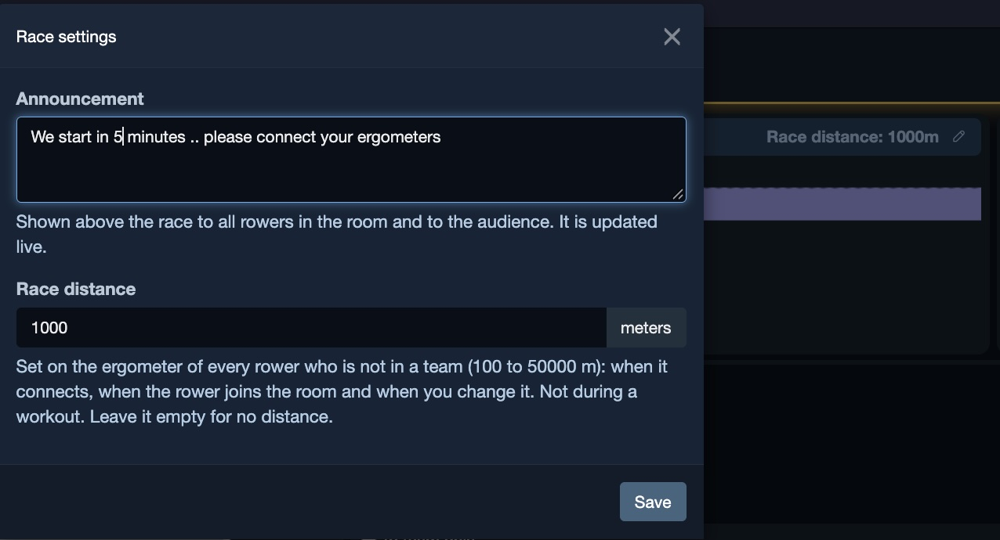
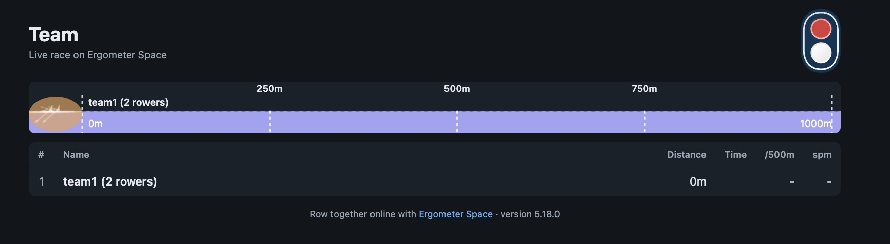
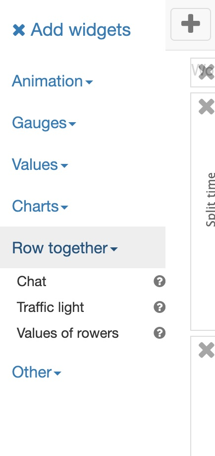

# Introduction

With Ergometer Space you can row together online. This document describes how to organize team rowing with direct login links, and how rowers join a team and start racing.

Ergometer Space is available through:
* The [website](https://ergometer-space.org/). Use a Chromium-based web browser, like Chrome or Edge.
* Android: [download it from the Play Store](https://play.google.com/store/apps/details?id=org.tijmenvangulik.ergometerspace)
* iOS: [download it from the App Store](https://apps.apple.com/us/app/ergometer-space/id1548193188)

# Roles

There are 4 roles:

* Solo rower: a rower who does not row in a team and has their own boat.
* Team captain: the first team member who logs in becomes the team captain. The team captain is the owner of the team. When the team captain logs off, another team member becomes captain.
* Team rower: a rower who joins a team. Team rowers row in one boat. The boat moves at the average speed of all the rowers in the team.
* Observer: watches the race with the full dashboard, like a coach, and is not shown in the race widgets. The race results are added to the workout log of the observer. Use this role only for a few people; the public can watch with the audience link (see [Observer or audience?](TeamRowing.md#observer-or-audience)).

The person who creates the room is the **room creator**. With login links this is the first user who logs in with a link: that login creates the room. The room creator sets the race distance and the race announcement for everybody in the room.

# Race organizer

If you have many teams and several races that start at the same time, use a separate room for every race. Do not create too many rooms, because the server has a limit of 40 rooms.

Team boats move at the average speed of their rowers. This means that teams can race against each other, no matter how many rowers each team has.

The race organizer sends a link (URL) to everyone who is going to take part. In your email or message, tell the users what to do with the link. For example:

    Please open the link in a Chromium-based browser (for example Chrome or Edge), or in the Ergometer Space app on your phone or computer.
    When you use the app, copy the link, open "Direct login link" from the menu, paste the link into the text box and press Login.

## Creating links
To create a link, open "Direct login link" from the menu and go to the Create tab.

All the settings of the room are stored in the link. When you change a setting, for example the password or a login type, you have to send the new link to the users. If one of your users still uses an old link, things can go wrong: for example, when that user creates the room with the old password, the other users cannot log in because they use the new password. It is best not to change these settings. If you do change them, also change the room name when you send the new links to all your users.

Fill in:
* Room name: use a unique name.
* Room password: the password of the room. Give every user the same password, not a different one.
* User name: send every user a different link with a unique user name.
* Login type: users cannot change their login type. A team rower can join another team, but team captains cannot, because they are the owner of their team. If you want users to be able to change roles, send them several links, or let them log off and log in again with another role.
* Distance: for team rowers. This is the race distance of the room. The user who creates the room with their link sets this distance for everybody, so give all users of the room the same distance. When the room already has a distance, the distance in the link is not used.
* Include dashboard: check this to send a prepared dashboard to the users. An observer may want to see other things than a rower. When you use a map for the race, you may want to include the map widget. The positions of the widgets in your current dashboard are exported (not all the settings of the widgets).
* Hidden room: your private room is not shown publicly to other users. Users can only log in with a direct login link, not from the menu. This option makes it a bit safer: if someone knows your room name, they could create a room with the same name just before you, with a different password. Then you and your users cannot log in anymore and you have to create new links. With this option nobody else sees your room name.
* Welcome text: a text that is shown before the user logs in.
* Map: the URL of a KML file with the map. This is nice when you want to row a race that is normally on the water online, on ergometers. See the topic [maps](Maps/index.md).

Press Create to make a link. You can change or copy the link afterwards in a text editor or a spreadsheet. Be careful: do not use special characters or normal spaces in a link. When the link is edited incorrectly, it does not work anymore.

* The link contains the version of the app in which you created it. The users you send the link to should use the same version or a newer one.

Example URLs that you can send to users. The examples include a dashboard and a map:
* Solo rower: [link](https://ergometer-space.org?action=doLogin&version=3.5.3&roomName=Room1&password=room1password&userName=Rower1&loginType=SoloRower&map=https://tijmenvangulik.github.io/Ergometerspace/data/maps/TheBoatRace.kml&dashboard=%7B%22widgets%22:%5B%7B%22name%22:%22TrainingDataWidget%22,%22x%22:0,%22y%22:0,%22width%22:3,%22height%22:1,%22percentageChartVisible%22:true,%22valueFontSize%22:100,%22sparkLineVisible%22:true%7D,%7B%22name%22:%22MapWidget%22,%22x%22:2,%22y%22:8,%22width%22:2,%22height%22:10,%22valueFontSize%22:100%7D,%7B%22name%22:%22RaceTrackWidget%22,%22x%22:0,%22y%22:1,%22width%22:3,%22height%22:7,%22valueFontSize%22:100%7D,%7B%22x%22:0,%22y%22:8,%22width%22:2,%22height%22:10,%22valueFontSize%22:100,%22name%22:%22chatWidget%22%7D,%7B%22x%22:3,%22y%22:0,%22width%22:1,%22height%22:8,%22valueFontSize%22:100,%22name%22:%22TrafficLightWidget%22%7D%5D%7D&welcome=Welcome%20to%20the%20race)
* Team rower: [link](https://ergometer-space.org?action=doLogin&version=3.5.3&roomName=Room1&password=room1password&userName=Rower2&teamName=Team1&loginType=TeamRower&distance=1000&map=https://tijmenvangulik.github.io/Ergometerspace/data/maps/TheBoatRace.kml&dashboard=%7B%22widgets%22:%5B%7B%22name%22:%22TrainingDataWidget%22,%22x%22:0,%22y%22:0,%22width%22:3,%22height%22:1,%22percentageChartVisible%22:true,%22valueFontSize%22:100,%22sparkLineVisible%22:true%7D,%7B%22name%22:%22MapWidget%22,%22x%22:2,%22y%22:8,%22width%22:2,%22height%22:10,%22valueFontSize%22:100%7D,%7B%22name%22:%22RaceTrackWidget%22,%22x%22:0,%22y%22:1,%22width%22:3,%22height%22:7,%22valueFontSize%22:100%7D,%7B%22x%22:0,%22y%22:8,%22width%22:2,%22height%22:10,%22valueFontSize%22:100,%22name%22:%22chatWidget%22%7D,%7B%22x%22:3,%22y%22:0,%22width%22:1,%22height%22:8,%22valueFontSize%22:100,%22name%22:%22TrafficLightWidget%22%7D%5D%7D&welcome=Welcome%20to%20the%20race)
* Observer: [link](https://ergometer-space.org?action=doLogin&version=3.5.3&roomName=Room1&password=room1password&userName=Coach1&loginType=Observer&map=https://tijmenvangulik.github.io/Ergometerspace/data/maps/TheBoatRace.kml&dashboard=%7B%22widgets%22:%5B%7B%22name%22:%22MapWidget%22,%22x%22:2,%22y%22:7,%22width%22:2,%22height%22:10,%22valueFontSize%22:100%7D,%7B%22name%22:%22RaceTrackWidget%22,%22x%22:0,%22y%22:0,%22width%22:2,%22height%22:9,%22valueFontSize%22:100%7D,%7B%22x%22:3,%22y%22:0,%22width%22:1,%22height%22:7,%22valueFontSize%22:100,%22name%22:%22chatWidget%22%7D,%7B%22x%22:2,%22y%22:0,%22width%22:1,%22height%22:7,%22valueFontSize%22:100,%22name%22:%22TrafficLightWidget%22%7D,%7B%22x%22:0,%22y%22:9,%22width%22:2,%22height%22:8,%22valueFontSize%22:100,%22name%22:%22RaceValuesWidget%22%7D%5D%7D&welcome=Welcome%20to%20the%20race)

After you have logged in you can open the "Teams & room users" dialog from the menu. This dialog shows the logged-in users, the teams and the race distance.

When you are the room creator, you see a bar above the race widget with a pencil button. With it you can set or change:
* the announcement: a text that is shown above the race to all rowers and to the audience;
* the race distance for all rowers in the room.

Start the race with the traffic light widget.

See the chapter [Organize your dashboard](#organize-your-dashboard) on how to prepare your dashboard.

Follow the race in the race widget.

Use the "Values of rowers" widget to see all the details of the rowers during the race.

At the end of the race you can see the end times of all the rowers in the workout log (open it from the menu).

As organizer you should not invite too many users as observers, because this increases the network load and can lower the quality of the race. For a large audience, use the public audience link instead (see below).

## Public audience

People who do not row can watch the race live in a web browser, without logging in. Check **Public audience** when you create the private room from the menu ("Create private room"). After the room is created you get the audience link. Everybody who is logged in to the room can also find it in the menu ("Audience link") and in the "Teams & room users" dialog. Share this link with your audience.

The audience page shows the race, the traffic light, the announcement and a table with the results. See [Public audience](TeamRowing.md#public-audience) for more details.

# Observers

Please open the link you received in a Chromium-based browser (for example Chrome or Edge), or in the Ergometer Space app on your phone or computer.
When you use the app, copy the link, open "Direct login link" from the menu, paste the link into the text box and press Login.

Now you can watch the race and chat with the rowers.

See the chapter [Organize your dashboard](#organize-your-dashboard) on how to prepare your dashboard.

Enjoy watching the race.

# Solo rowers

Please open the link you received in a Chromium-based browser (for example Chrome or Edge), or in the Ergometer Space app on your phone or computer.
When you use the app, copy the link, open "Direct login link" from the menu, paste the link into the text box and press Login.

After you have logged in, connect your ergometer. When the room has a race distance and your ergometer is connected over Bluetooth or USB, Ergometer Space sets this distance on your ergometer automatically, but never while you are rowing a workout. Otherwise, set your ergometer to the race distance yourself.

See the chapter [Organize your dashboard](#organize-your-dashboard) on how to prepare your dashboard for racing.

# Team rowers

Please open the link you received in a Chromium-based browser (for example Chrome, Edge, Brave or Opera), or in the Ergometer Space app on your phone or computer.
When you use the app, copy the link, open "Direct login link" from the menu, paste the link into the text box and press Login.

When you are the first team member who logs in, you become the team captain. The team captain is the owner of the team. When the team captain logs off, another team member becomes captain.

Your ergometer must be set to "just row", not to the distance of the race. When your ergometer is connected over Bluetooth or USB, Ergometer Space does this for you, but never while you are rowing a workout. The boat moves at the average speed of the rowers. At the end of the race the distance on your ergometer can be longer than the race distance, and a team member who rowed slower has a shorter distance.

A team member who has finished keeps their distance in the team average, also when they reset their ergometer. The boat finishes when the average distance of all team members reaches the race distance.

See the chapter [Organize your dashboard](#organize-your-dashboard) on how to prepare your dashboard for racing.

## Organize your dashboard

These widgets are important for team racing:

1. Race widget
2. Chat widget
3. Traffic light
4. Values of rowers

The race widget is visible by default. You have to add the other widgets yourself.
To add widgets, click the edit icon in the top right corner:

Then click the + button in the left corner to open the widget menu. Open the "Row together" section and add at least the Chat widget and the Traffic light widget:

Coaches can also add the "Values of rowers" widget to see the details of the race.

The widget with the 3D rower uses a lot of processing power and energy. If you do not use it, it is better to remove it.

The widgets in detail:

## Race widget

This widget shows the other rowers and teams and the progress of the race. The animated rower on the orange background is the actual position of the rower. The gray boat behind it is the projected position: where the rower would be if you and the other rower had started at exactly the same time. This makes it possible to race against someone who started a bit earlier or later.

Dashed lines in the water mark the distance in meters. Above the race you see the announcement and the race distance of the room.

## Chat widget

Here you can chat with everybody in the same room. Click the speaker button to turn on audio. Check "to team only" to send messages only to your own team. This only works when you have joined a team.

## Traffic light widget

The traffic light helps everybody start at the same time. Click the traffic light to open a dialog in which you start it. The traffic light counts down, and turns green when the race starts.

## Values of rowers widget

Shows the details of all the rowers. This is useful for the coach. Not all values are shown by default: in the dashboard edit mode you can choose which columns are shown.

# Troubleshooting room connections

From the menu you can open the "Teams & room users" dialog. It shows all the users in the room. When a user has joined but is not connected correctly because of connection problems, the list shows it after the user name. These are the possible messages:
  - not connected! old version of the app.
    This user should upgrade to the latest version (at least 3.5.0).
  - Connected via server, no audio.
    The user is connected and you can row together. This happens when the network does not support direct connections: then the communication goes through the central server, which can make the updates a bit slower. Audio is not supported for this user. Using Wi-Fi instead of a mobile connection may help.
  - not connected!
    The user cannot connect at all. Maybe the network itself is down. Check your Wi-Fi, network cables or mobile network.

As an alternative you can create a room with the "Backwards compatible room" option checked. This kind of room has fewer problems with network connections. The disadvantage is that these rooms are much slower and scale less well, which results in slower updates.
